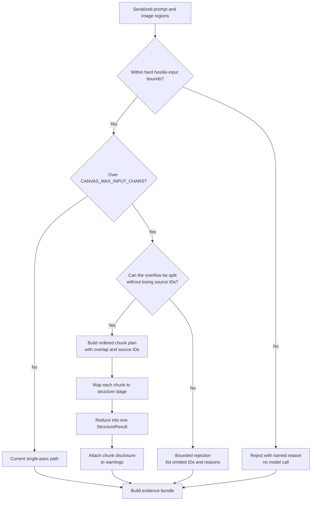
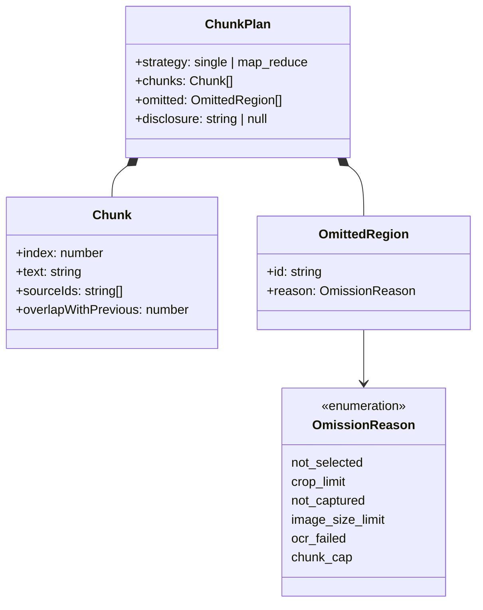

# Bounded OCR Input and Chunking Architecture

**Research snapshot:** 2026-11-20
**Scope:** Schematic design only. No application code was changed.
**Parent:** [Canvas intelligence architecture additions](2026-11-20-canvas-intelligence-architecture-additions.md)

---

## Problem

- `server/canvas-intelligence/service.ts:72-74` throws when the serialized prompt exceeds `CANVAS_MAX_INPUT_CHARS` (default 60,000): a larger board fails outright rather than completing slowly.
- Region and image budgets are already explicit and disclosed: three regions per analysis by default (`src/canvas/ocr-regions.ts:9`), an eight-region hard ceiling (`:10`), an 8 MiB image budget (`service.ts:78-84`), and `omittedImageRegionIds` (`:86`).
- `server/canvas-analysis/producer.ts:121-130` already has a five-value omission taxonomy: `not-selected`, `crop-limit`, `not-captured`, `image-size-limit`, `ocr-failed`.

The current behavior is therefore correct for hostile input but too strict for legitimate large boards. The addition separates those two cases.

## Evidence from source repos

| Pattern | Source | Exact mechanism |
|---|---|---|
| Chunk so any size completes | NitroAI `src/lib/generation/chunk.ts` | `estimateTokens = ceil(chars / 4)`; split on paragraph, then sentence, then hard character boundaries with optional overlap[^1] |
| Map-reduce over sections | NitroAI `src/lib/generation/index.ts` and its test | Section maps plus a reduce step; the test asserts more than one model call for a ~62k-character source[^1] |
| Segment and disclose | TurboGoo `src/lib/ingest.ts` | Render large pages at a capped scale, OCR the first 25, and append an explicit `[Only the first 25 of N pages were read]` notice rather than silently truncating[^2] |
| Capacity pairing | TurboGoo `src/lib/ai.ts` | Output size is derived from input size rather than from a fixed user request[^2] |
| Reject hostile input by construction | PdfCraft `crates/ocr/src/lib.rs` | `OcrImage` has private validated state: 10,000-pixel side cap, 64-megapixel area cap, exact buffer length, checked arithmetic[^3] |
| Gate expensive work | PdfCraft `crates/ocr/src/pitch.rs` and `tiles.rs` | Autocorrelation of per-row ink finds line pitch; tiling runs only when small text on a large page makes it worthwhile; 4 percent overlap with core-cell deduplication[^3] |
| Bound before allocating | PdfCraft `crates/engine/src/ocr.rs` | Refuse more than 65,536 words, more than 4 MiB of text, or non-finite geometry before cloning words or planning fonts[^3] |

## Decision flow

### Chunk plan shape

## Insertion points

| File and location | Change |
|---|---|
| `server/canvas-intelligence/service.ts:72-74` | Replace the unconditional throw with a call to a chunk planner; keep the throw only for input that cannot be split safely |
| `server/canvas-intelligence/input.ts` | Add a `buildChunkPlan(normalizedInput, budget)` helper that preserves source IDs |
| `server/canvas-intelligence/service.ts:75-129` | Map over chunks with the existing cache and fallback machinery, then reduce using a dedicated prompt |
| `server/canvas-intelligence/prompts.ts` | Add a reduce prompt that merges structures without inventing object IDs |
| `server/canvas-analysis/producer.ts:121-130` | Accept the additional `chunk_cap` omission reason |
| `src/canvas/ocr-regions.ts:6` | Extend the omission reason union if the client also plans chunks |
| `tests/canvas-intelligence.test.ts` | Add a large-input case asserting more than one model call and stable object IDs |

## Invariants

- Hostile input is rejected before any model call or large allocation.
- Existing caps are unchanged: three regions per analysis, eight-region ceiling, 8 MiB image budget, 60,000-character completion budget.
- Every chunk retains the source IDs of its records; the reduce step never invents a new canvas object ID.
- Chunk order is deterministic so cache keys and benchmark results stay stable.
- Omission is always disclosed; no region is silently dropped.
- A chunked run reports `partial: true` unless the reduce step produced a complete structure.
- Tiling is a later, optional path gated by pitch analysis; it is not part of this addition.

## Verification gates

1. Raising any cap or budget requires an ADR in `docs/decisions/`. This addition changes the behavior at an existing cap without raising it, so document that explicitly in the ADR.
2. Run `npm run benchmark:canvas` and quote all four gates against the baseline: `mathExactCount=4`, `mathAverageF1=0.91`, `physAlignStructureCoverage=0.75`, `averageLatencyMs=16579`. Chunking may change latency; a regression requires re-review, not an automatic baseline update.
3. Add unit tests for boundary values at the existing caps and for deterministic chunk ordering.
4. Add a Playwright assertion that a large board completes and that its disclosure text is visible in the DOM.
5. Run `npm run verify`.

## Sourcing boundary

NitroAI is AGPL-3.0 and TurboGoo has no license; only their algorithms and invariants are described here, re-expressed for StudyAI. PdfCraft is MIT OR Apache-2.0 and supplies the hostile-input and pitch-gating patterns. No source text from any of the three repos is reproduced.

[^1]: NitroAI source: https://github.com/Blueturboguy07/NitroAI
[^2]: TurboGoo source: https://github.com/ishanasati/turbo-goo
[^3]: PdfCraft source: https://github.com/storytold/pdfcraft/tree/main/crates/ocr
