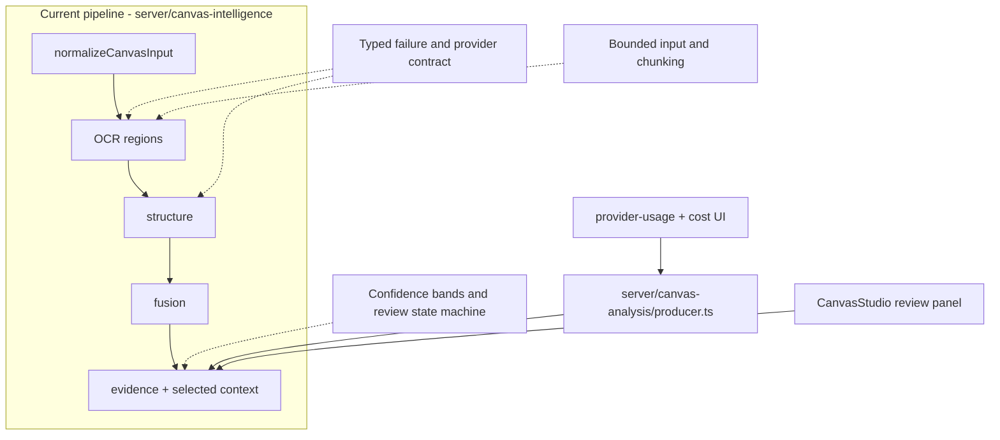

# StudyAI MK3 — Canvas Intelligence Architecture Additions

**Research snapshot:** 2026-11-20
**Scope:** Read-only architecture research. No application code, dependency, benchmark data, model weight, or index was changed.
**Input:** Cross-research of three open-source repos listed on Publik against the local `server/canvas-intelligence/` stack.

---

## Decision

Adopt three additive changes to canvas intelligence, in this order. None replaces the current OCR, geometry, scene, or fusion authorities.

1. **Typed failure and provider contract** — make failure modes and effective providers first-class so provenance stops recording `"system"` for cloud stages.
2. **Confidence bands and a review state machine** — make "unknown is never confident" explicit and give the existing review panel undo, stale guards, and uncertainty navigation.
3. **Bounded input and chunking** — keep the current reject-and-disclose behavior for hostile input, but add a chunked completion path so large boards no longer hard-fail.

The detailed schematics are linked from [the additions table](#the-additions).

## Source evidence

| Repo | Role in this research | License | What may be used |
|---|---|---|---|
| `storytold/pdfcraft` | OCR engineering reference: confidence bands, review workflow, bounded image types, in-place word rewrite | MIT OR Apache-2.0 for code; ocrs `.onnx` weights CC-BY-SA-4.0 | Patterns and, where useful, code — not the model weights or brand assets[^1][^2] |
| `Blueturboguy07/NitroAI` | Provider/resilience reference: engine contract, capability bitset, typed errors, tier retry, measured token budgets | AGPL-3.0 (README: or-later), network source-disclosure clause | **Ideas only** — reimplement, do not copy source[^3] |
| `ishanasati/turbo-goo` | Local-first reference: two-tier routing, defensive LLM client, dual engine, labelled offline fallbacks | **None** — all rights reserved | **Ideas only** — no source copying without permission[^4] |
| Publik API | Potential text-only provider; no documented vision-input endpoint | Proprietary | Do not assume OCR capability[^5] |

Repo vitality at verification: PdfCraft 21,330 stars / 7,719 forks (organization-owned), NitroAI 138 / 32, TurboGoo 1 / 1 (nine days old). Licensing therefore also aligns with technical fit: the strongest engineering match is the only one whose code may be reused.

## Target component map

The diagram shows the current pipeline and where the three additions attach. Dashed edges are proposed, not implemented.

## The additions

| # | Document | Problem it solves | Primary insertion points |
|---|---|---|---|
| 1 | [Typed failure and provider contract](2026-11-20-typed-failure-provider-contract.md) | `CanvasUnderstanding` carries string warnings; producer cannot name the effective provider for OCR/structure/fusion | `service.ts:23`, `providers.ts:45-76`, `producer.ts:137-139` |
| 2 | [Confidence bands and review state machine](2026-11-20-confidence-review-state-machine.md) | Missing confidence has no explicit semantics; review edits are neither undoable nor stale-checked | `evidence.ts:22-25`, `recognition/feedback.ts`, `CanvasStudio.tsx:716-732` |
| 3 | [Bounded input and chunking](2026-11-20-bounded-ocr-chunking-architecture.md) | A prompt over 60,000 characters throws instead of completing | `service.ts:72-84`, `src/canvas/ocr-regions.ts:9-17` |

## Cross-pattern basis

| Concern | PdfCraft | NitroAI | TurboGoo | StudyAI today |
|---|---|---|---|---|
| Untrustworthy output | Human review; nothing applied until Accept | Typed error; retry on other tier; never save partial JSON | Retry with thinking off; label degraded output | Normalization warnings plus accept/reject/correct |
| Confidence | Bands 90/70, separate batch threshold, unknown is never good | Provider-reported, used for budget decisions | Token telemetry only | `number \| null` plus `uncertain` |
| Large input | Reject hostile input by construction; tile only when pitch says needed | Chunk so any size completes | Segment and map-reduce | Bound, disclose omissions, throw at 60k chars |
| Provider model | `Recognizer` trait with `id`, availability, languages | `Engine` interface plus capability bitset | Configurable per-feature endpoints | Four separate resolver functions |
| Provenance | Provenance records | `Engine.provider` plus usage headers | Request-stat ring buffer | `"system"` for cloud stages |

## Gates and constraints

- Any prompt, model, or provider change requires `npm run benchmark:canvas` against `docs/verification/canvas-benchmark-baseline.json`, with all four gate numbers quoted: `mathExactCount=4`, `mathAverageF1=0.91`, `physAlignStructureCoverage=0.75`, `averageLatencyMs=16579` (`hardFailures=0`) at `docs/verification/canvas-benchmark-baseline.json:3-20`[^6].
- Lowering OCR region caps, provider budgets, or recognition confidence thresholds requires an ADR in `docs/decisions/`.
- UI-visible changes require a browser-level Playwright assertion of the rendered DOM; unit tests on helpers are not sufficient.
- No `@ts-ignore`, `@ts-nocheck`, `as any`, or `as never` to make a type compile.
- `server/canvas-intelligence/scene/` remains the only authority for whole-board interpretation; none of these additions creates a second interpretation path.
- `npm run verify` is `tsc -b && vitest run && playwright test` (`package.json:18`).

## Verification status

Nothing in this document set has been implemented, compiled, or benchmarked. `npm run verify` and `npm run benchmark:canvas` were not run. The diagrams are design schematics, not as-built architecture.

## Related documents

- [Second-pass architecture research: joint ink, objects and relationships](2026-11-12-joint-ink-object-architecture.md)
- [Custom multimodal canvas feasibility](2026-11-11-custom-multimodal-canvas-feasibility.md)
- [Canvas intelligence handoff](../CANVAS_INTELLIGENCE_HANDOFF_2026-11-18.md)

[^1]: PdfCraft repository and license files: https://github.com/storytold/pdfcraft
[^2]: PdfCraft OCR crate source: https://github.com/storytold/pdfcraft/tree/main/crates/ocr
[^3]: NitroAI repository: https://github.com/Blueturboguy07/NitroAI
[^4]: TurboGoo repository: https://github.com/ishanasati/turbo-goo
[^5]: Publik API documentation: https://publikhq.com/developers
[^6]: Baseline values read from the local file `docs/verification/canvas-benchmark-baseline.json:3-20` on 2026-11-20.
