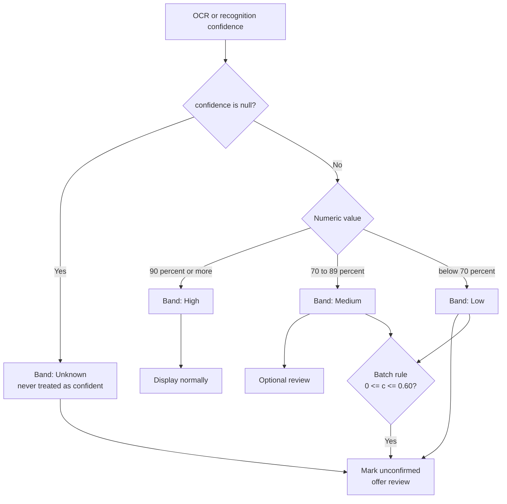
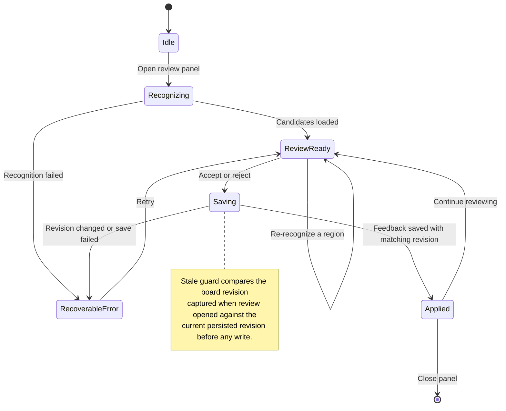
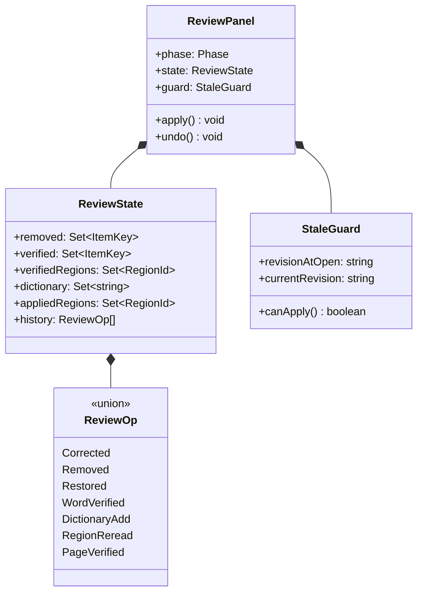

# Confidence Bands and Review State Machine for Canvas Recognition

**Research snapshot:** 2026-11-20
**Scope:** Schematic design only. No application code was changed.
**Parent:** [Canvas intelligence architecture additions](2026-11-20-canvas-intelligence-architecture-additions.md)

---

## Problem

- `server/canvas-intelligence/evidence.ts:22-25` stores `confidence: number | null`, `uncertain: boolean`, and `uncertaintyReasons: string[]`, but has no rule for what a `null` confidence means beyond being carried forward.
- The review panel at `src/canvas/CanvasStudio.tsx:716-732` is a flat list with a percentage, an alternatives count, and Accept / Correct / Dismiss. Review edits are not undoable and are not checked against the board revision.
- `server/canvas-intelligence/recognition/feedback.ts:17-30` persists `accept | reject | correct` decisions keyed by a sorted stroke-group key (`:34-36`) with hard caps at `:14-15`. It has no undo history and no staleness field.
- The benchmark baseline shows the live failure mode in prose: associations are reported as unconfirmed "due to missing confidence scores" for the PhysAlign board (`docs/verification/canvas-benchmark-baseline.json:350`).

## Evidence from source repos

| Pattern | Source | Exact mechanism |
|---|---|---|
| Confidence bands | PdfCraft `crates/ocr/src/confidence.rs` | `band_for`: High >= 90, Medium 70-89, Low < 70; out-of-range clamps; NaN is Low; boundary tests at 89/90 and 69/70[^1] |
| Separate batch threshold | Same file | `low_confidence(conf, 60)` is deliberately distinct from the bands: 65 is Low-band but not batch-flagged[^1] |
| Unknown is never good | Same file | `is_suspect(None) === false`; `mean_confidence()` returns `None` when no word reports confidence rather than counting it as 100[^1] |
| Review lifecycle | PdfCraft `crates/ui-egui/src/workflows/ocr_verify.rs` | `Phase = Idle, Running, ReviewReady, Saving, RecoverableError`; tools are active only in the correct phase[^1] |
| Undoable review edits | Same file | `Review` holds removed, verified, verified_pages, dictionary, applied_pages, and a `Vec<Op>` history; each `Op` carries `before` payloads; review edits are not document edits[^1] |
| Stale result refusal | PdfCraft `crates/engine/src/ocr.rs` | `apply_ocr_checked` refuses a result when the document generation changed between read and apply[^1] |
| Navigate by uncertainty | PdfCraft `ocr_verify.rs` | `is_uncertain()` plus `goto_uncertain` walks low-band or dictionary-absent words; suggestions use edit distance <= 2[^1] |
| Flag, do not fix | TurboGoo `src/lib/ai.ts` `annotate` | Margin comments of kind `error`, `gap`, or `tip` anchored to an exact substring; never rewrites the source[^2] |

## Confidence model

The bands are a semantic clarification, not a lowering of any threshold. StudyAI keeps its existing 0-1 scale in `evidence.ts`; the bands are derived at display and review time.

| Band | Normalized range | Meaning | Review behavior |
|---|---|---|---|
| High | `>= 0.90` | Trustworthy for display | No flag |
| Medium | `0.70 - 0.89` | Usable but worth a glance | Optional flag |
| Low | `< 0.70` | Suspect | Flag and offer review |
| Unknown | `null` | No signal at all | Never treated as High; flag as unconfirmed, not as wrong |

A separate batch rule (default `0.60`) decides which items are included in a "review these" batch. It must remain distinct from the Low band so the two can disagree without a bug.

## Review state machine

The state machine is a proposed overlay on the existing panel. It preserves the verified invariant that feedback and teaching never mutate the board revision or document (`tests/e2e/canvas-recognition-review.spec.ts:89-91`).

### Undo model

The review history is local to the panel, mirroring the source pattern. It is intentionally not persisted and is not a canvas edit.

## Insertion points

| File and location | Change |
|---|---|
| `server/canvas-intelligence/evidence.ts:7-36` | Add derived band fields and an `unknown` reason to `CanvasEvidenceSchema` |
| `server/canvas-intelligence/recognition/feedback.ts:17-30` | Add `revision` and `before` columns for undo-capable review records, or keep undo client-side only |
| `src/canvas/CanvasStudio.tsx:716-732` | Add confidence colouring, a "next uncertain" control, and an Undo button |
| `tests/canvas-recognition-feedback.test.ts` | Assert band boundaries and that unknown confidence is never treated as confident |
| `tests/e2e/canvas-recognition-review.spec.ts` | Extend the existing test with Undo, stale-revision rejection, and uncertainty navigation |

## Invariants

- A `null` confidence is never rendered as a high-confidence label.
- The batch threshold and the Low band are separate rules; neither is derived from the other.
- Review edits never write `canvases.document`; `revision` and document JSON are unchanged after Accept, Reject, Teach, or Undo.
- Accepting a whole review after accepting individual regions must not double-apply either one.
- A stale revision rejects the write and returns to `ReviewReady` with a named reason.
- Corrections are suggested, never applied automatically.
- The dictionary is keyed by recognition language, not interface locale.

## Verification gates

1. This change does not lower a recognition confidence threshold, so no threshold ADR is required; document the band semantics in the schematic and in code comments.
2. Add boundary tests at 0.69, 0.70, 0.89, and 0.90, plus explicit `null` and `NaN` cases.
3. Add a Playwright assertion of the rendered DOM for band colouring, Undo, and the stale-revision message. Helper-only unit tests do not satisfy the UI verification rule.
4. Run `npm run benchmark:canvas` and quote all four gates; band changes affect how evidence is displayed but must not change benchmark scores.
5. Run `npm run verify`.

## Sourcing boundary

PdfCraft's code is MIT OR Apache-2.0, so its algorithms may be reimplemented or ported; its two ocrs `.onnx` weights are CC-BY-SA-4.0 and are not part of this addition. TurboGoo has no license, so only the "flag, do not fix" idea is reused — no source text.

[^1]: PdfCraft source: https://github.com/storytold/pdfcraft/tree/main/crates/ocr and https://github.com/storytold/pdfcraft/tree/main/crates/ui-egui/src/workflows
[^2]: TurboGoo source: https://github.com/ishanasati/turbo-goo
