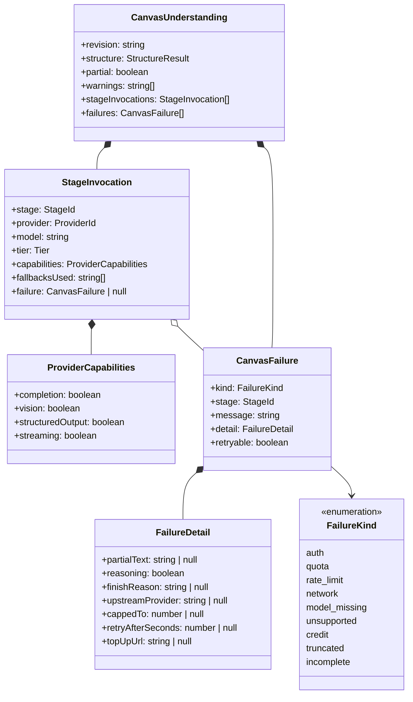
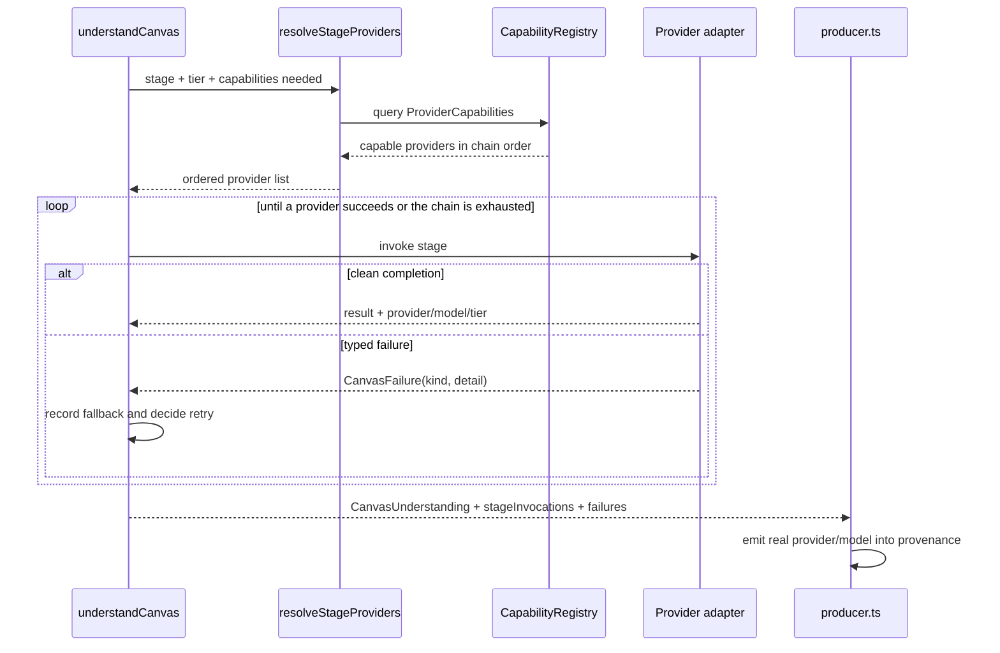
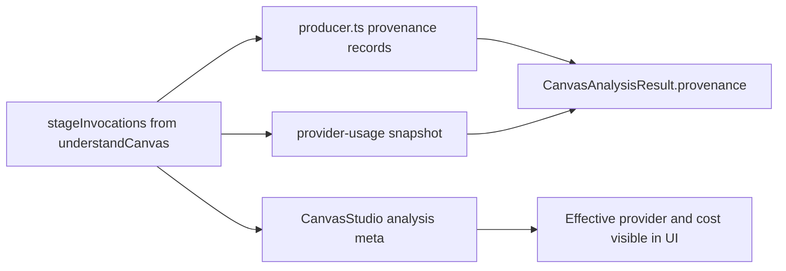

# Typed Failure and Provider Contract for Canvas Intelligence

**Research snapshot:** 2026-11-20
**Scope:** Schematic design only. No application code was changed.
**Parent:** [Canvas intelligence architecture additions](2026-11-20-canvas-intelligence-architecture-additions.md)

---

## Problem

Three gaps were verified in the current code.

1. **Failures are strings.** `CanvasUnderstanding` at `server/canvas-intelligence/service.ts:23` exposes `partial?: boolean`, `warnings?: string[]`, `omittedImageRegionIds?: string[]`, and `failedImageRegionIds?: string[]`. There is no typed distinction between "the model stopped at the output cap", "the provider refused", and "the provider was unavailable".
2. **The effective provider is not exposed.** `server/canvas-analysis/producer.ts:137-139` writes `"Canvas Intelligence OCR stage; effective provider is not exposed by understandCanvas"` and records `provider: "system"` for OCR, structure, and fusion. The benchmark baseline, by contrast, records real `gemini` and `groq` calls (`docs/verification/canvas-benchmark-baseline.json:58-72`).
3. **Provider resolution is split.** `server/canvas-intelligence/providers.ts:45-76` has separate resolvers for completion, vision, math OCR, and diagram OCR. There is no explicit capability model, so "this provider has no vision" is a filter side effect rather than a testable state.

## Evidence from source repos

| Pattern | Source | Exact mechanism |
|---|---|---|
| Typed error taxonomy | NitroAI `src/lib/engine/types.ts` | `EngineError.kind` covers `auth`, `quota`, `rate_limit`, `network`, `model_missing`, `unsupported`, `credit`, `truncated`, `incomplete`, `unknown`; `EngineErrorDetail` carries `partialText`, `reasoning`, `finishReason`, `upstreamProvider`, `cappedTo`, `topUpUrl`[^1] |
| Only a clean stop is whole | NitroAI `src/lib/engine/engine.test.ts` | The whole-answer fixture sends `finish_reason: "stop"`; any other end is not treated as a complete answer[^1] |
| Capability bitset | NitroAI `src/lib/engine/router.ts` | `EngineCapabilities` with `chat`, `transcription`, `tts`, `embeddings`; `supportsTask()` and a user-facing `unsupportedMessage()`[^1] |
| Retry discipline | NitroAI `src/lib/engine/resilient.ts` and its test | Retries only `rate_limit`/`network` with delays 3000/8000/20000/40000 ms; never retries mid-stream; `auth` is never retried[^1] |
| Usage telemetry | NitroAI `src/lib/publik.ts` | Balance store fed by `x-publik-*` headers; streams marked stale until a wallet refresh[^1] |
| Request telemetry | TurboGoo `src/lib/llm.ts` | `ReqStat` ring buffer of first-token ms, total ms, output and reasoning tokens, characters, success flag[^2] |
| Provider identity on the wire | Publik API | Universal response headers include `x-publik-model`, `x-publik-request-id`, `x-publik-week-used`; charges use `x-publik-charge-micros` or `x-publik-reserved-micros`[^3] |

## Proposed contract

The proposed types are additive to `CanvasUnderstanding`. They are a reimplementation of the observed behavior, not a copy of NitroAI source (which is AGPL-3.0).

### Stage identity

`StageId` is the set of stages the producer already distinguishes: `ocr`, `structure`, `fusion`, and `recognition`. `Tier` is `fast` or `strong`, matching the existing math/diagram model helpers in `providers.ts:78-140`.

## Resolution and failure flow

### Retry rules

| Failure kind | Retry | Reason |
|---|---|---|
| `rate_limit`, `network` | Yes, bounded backoff, never mid-stream | Transient; matches NitroAI `resilient.ts` |
| `truncated` on a reasoning model | Once on the other tier | A capped answer can become whole on a fast model |
| `incomplete` (filter, provider error, no finish reason) | Once on the other tier, then stop | A different provider may not apply the same filter |
| `auth`, `quota`, `credit`, `model_missing`, `unsupported` | No | User action or configuration is required |
| Any failure after a stream has emitted text | No automatic re-emission | Prevent duplicated tokens |

## Effective provider propagation

This closes the gap at `producer.ts:137-139` without changing the analysis contract shape: `provenance[].provider` and `provenance[].model` are already fields.

## Insertion points

| File and location | Change |
|---|---|
| `server/canvas-intelligence/service.ts:23` | Add `stageInvocations` and `failures` to `CanvasUnderstanding` |
| `server/canvas-intelligence/providers.ts:6-76` | Add `ProviderCapabilities` and one `resolveStageProviders()` facade over the four existing resolvers |
| `server/canvas-intelligence/groq.ts` adapter boundary | Map finish reasons and HTTP statuses to `CanvasFailure`; preserve partial text |
| `server/canvas-analysis/provider.ts` (producer, lines 133-140) | Replace `"system"` with `stageInvocation.provider` and `model` |
| `src/canvas/CanvasStudio.tsx:744-745` | Optionally surface per-stage provider in the existing analysis meta output |

## Invariants

- A provider with `vision: false` is never selected for an OCR stage.
- No stage records `provider: "system"` when a remote model was actually called.
- `partial: true` always has at least one corresponding typed failure with a reason.
- Partial text is never persisted as if it were a whole answer.
- Adding or reordering a provider does not change the meaning of existing evidence IDs.

## Verification gates

1. Record an ADR in `docs/decisions/` describing the new provider and capability model.
2. Run `npm run benchmark:canvas` and quote all four gates against the baseline: `mathExactCount=4`, `mathAverageF1=0.91`, `physAlignStructureCoverage=0.75`, `averageLatencyMs=16579`.
3. Add unit tests mapping each finish reason and HTTP status to the correct `FailureKind`, including "only `stop` is whole".
4. Add a Playwright assertion that provenance shows a real provider for an OCR stage.
5. Run `npm run verify`.

## Sourcing boundary

NitroAI is AGPL-3.0 and TurboGoo has no license. The types, rules, and diagrams here are re-expressed in StudyAI's own vocabulary from the observed behavior. No source text from either repo is reproduced. PdfCraft is MIT OR Apache-2.0 but is not the source for this particular addition.

[^1]: NitroAI source files: https://github.com/Blueturboguy07/NitroAI
[^2]: TurboGoo source files: https://github.com/ishanasati/turbo-goo
[^3]: Publik API documentation: https://publikhq.com/developers
